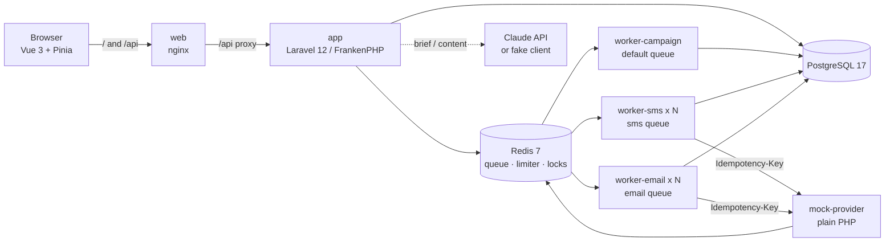
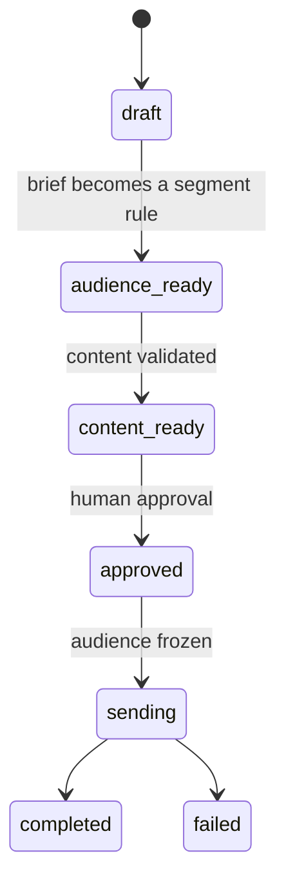

# Smart Campaign Composer

A marketer writes a campaign brief in plain language. Claude turns it into a segment rule and SMS/email copy, a human previews, edits and approves it, the messages go through a queue to a mock provider, and a dashboard shows delivery status live.

## Setup

Requirements: Docker. Node, PHP and Composer are not needed on the host (Node is needed only for `make e2e` and `make smoke`).

```
cp .env.example .env
docker compose up -d --build
```

Then open <http://localhost:8080>. The API health check is at <http://localhost:8080/api/health>, metrics at <http://localhost:8080/api/metrics>.

- Migrations and the seed (5,000 customers) run automatically when the `app` container starts.
- `ANTHROPIC_API_KEY` is optional. Without it the app runs on a built-in fake LLM (`LLM_DRIVER=auto`) and logs a warning; `/api/health` reports the active `llm_driver`. To use Claude, put the key in `.env` and run `docker compose up -d`.
- Boost (the Laravel MCP server used during development) needs `APP_ENV=local` in `backend/.env`. `.env.example` already sets it for the Docker stack.
- To work on the UI with hot reload, keep the stack running and start `npm run dev` in `frontend/` (needs Node on the host), then open <http://localhost:5173>. Vite forwards `/api` to the stack on port 8080. Without hot reload, `docker compose up -d --build web` rebuilds the served app.

Try it: open the UI, use the sample brief, check the channel counts, watch the content stream in, edit the SMS (the 161st character is refused), approve, and follow the dashboard until the campaign is `completed`.

## Architecture



- **Backend:** Laravel 12 on FrankenPHP (classic mode), JSON API only.
- **Data and queue:** PostgreSQL 17; Redis 7 for the queue (separate `sms` and `email` queues), the rate limiter and locks.
- **Workers:** the backend image runs again as `worker-sms`, `worker-email` (replica count per channel from `WORKERS_PER_CHANNEL`) and one `worker-campaign` that freezes the audience and queues the send jobs.
- **Frontend:** Vue 3, TypeScript, Pinia and Tailwind, served by nginx, which also proxies `/api` to the backend. The interface is available in Turkish and English.
- **Mock provider:** a separate container that enforces 100 messages per second per channel and injects delays and failures (500, 429, timeouts, accept-then-500).

The decisions behind these choices are recorded in [DECISIONS.md](DECISIONS.md).

## Flow



1. **Brief.** `POST /api/campaigns` creates a campaign from the plain-language brief.
2. **Audience.** Claude returns a segment rule. It is parsed and checked against `FieldRegistry` and becomes a typed value object; column names never come from the model and values are bound, so model output never becomes SQL. Criteria no field can express are reported back as unsupported. Opt-in is applied while counting, and the marketer sees per-channel counts.
3. **Content.** SMS and email copy streams to the browser over server-sent events. Model output and human edits go through the same validator (SMS ≤ 160, email subject ≤ 80, email body ≤ 2000 visible characters, counted after personalisation with the longest values in the audience).
4. **Approval.** The human approves once. Approving again is harmless (once sending has started it changes nothing), and an empty audience is refused.
5. **Sending.** The audience is frozen with one `INSERT … SELECT … ON CONFLICT DO NOTHING` (opt-in is checked again), and one job per delivery goes to the `sms` or `email` queue. Right before sending, opt-in is checked a second time. A global limit of 100 per second per channel applies, failures are retried by class with full jitter, and double sends are prevented by a DB unique key, an atomic claim and the provider `Idempotency-Key`.
6. **Dashboard.** Progress per channel and status, send rate, retries and recent errors stream live over SSE.

### Endpoints

| Method | Path                                 | Purpose                                                          |
| ------ | ------------------------------------ | ---------------------------------------------------------------- |
| GET    | `/api/health`                        | Database, Redis and provider checks, queue sizes, LLM driver     |
| GET    | `/api/metrics`                       | Delivery and LLM counters in Prometheus text format              |
| GET    | `/api/campaigns`                     | List campaigns                                                   |
| POST   | `/api/campaigns`                     | Create a campaign from a brief                                   |
| GET    | `/api/campaigns/{id}`                | Campaign with its rule, content and status                       |
| POST   | `/api/campaigns/{id}/audience`       | Extract the segment rule and count the audience                  |
| GET    | `/api/content/rules`                 | Content limits and personalisation variables                     |
| POST   | `/api/campaigns/{id}/content/stream` | Generate content (server-sent events: `delta`, `final`, `error`) |
| PUT    | `/api/campaigns/{id}/content`        | Save edited content (same validator as the model output)         |
| GET    | `/api/campaigns/{id}/preview`        | Personalised preview of the messages                             |
| POST   | `/api/campaigns/{id}/approve`        | Approve and start sending                                        |
| GET    | `/api/campaigns/{id}/stats`          | Progress snapshot                                                |
| GET    | `/api/campaigns/{id}/stats/stream`   | Live progress (server-sent events)                               |

Errors share one body: `{"error":{"code":"...","message":"...","details":{}}}`.

## Commands

`make` targets and their `docker compose` equivalents, for machines without `make` (Windows):

| Target               | Equivalent                                                                                                                                                        |
| -------------------- | ----------------------------------------------------------------------------------------------------------------------------------------------------------------- |
| `make up`            | `docker compose up -d --build`                                                                                                                                    |
| `make down`          | `docker compose down`                                                                                                                                             |
| `make logs`          | `docker compose logs -f --tail=100`                                                                                                                               |
| `make fresh`         | `docker compose exec app php artisan migrate:fresh --seed --force`                                                                                                |
| `make test-backend`  | `docker compose build app`, then `docker compose run --rm app vendor/bin/pest` (the code is baked into the image, so build first)                                 |
| `make test-mock`     | `docker compose run --rm -v ./mock-provider:/mock -w /mock app /app/vendor/bin/pest --configuration=/mock/phpunit.xml` (use an absolute host path for the volume) |
| `make lint-backend`  | `docker compose build app`, then `docker compose run --rm app sh -c "vendor/bin/pint --test && vendor/bin/phpstan --memory-limit=1G"`                             |
| `make test-frontend` | `docker build --target build -t smart-campaign-frontend:tools -f frontend/Dockerfile .` then `docker run --rm smart-campaign-frontend:tools npm test`             |
| `make lint-frontend` | same image, `npm run lint && npm run type-check && npm run format:check`                                                                                          |
| `make smoke`         | `node scripts/smoke.mjs` (stack must be running)                                                                                                                  |
| `make e2e`           | `docker compose up -d --build --wait`, then in `frontend/`: `npm ci && npx playwright install chromium && npx playwright test`                                    |

`make test` = `test-backend` + `test-mock` + `test-frontend`; `make lint` = `lint-backend` + `lint-frontend`.

## Tests

- **`make test`** runs the backend (Pest), mock provider (Pest, Redis db 1) and frontend (Vitest) suites inside Docker. Backend integration tests use the real Postgres and Redis containers, in a separate `campaign_test` database and Redis db, so development data is never touched.
- **`make lint`** runs Pint, Larastan, ESLint, the type check and Prettier.
- **`make smoke`** (stack running, Node on the host) sends a large campaign through the mock provider with its fault injection on, then compares the app's database with the provider's own counters: no duplicates, nothing lost, peak rate ≤ 100 per second per channel.
- **`make e2e`** drives the real stack in Chromium: brief → audience → streamed content → edit → approve → dashboard `completed`. Screenshots land in `frontend/e2e/artifacts/`.

The Claude Code tooling has its own tests:

```
node scripts/test-guard.mjs
node scripts/test-format.mjs
node scripts/test-scrub.mjs
```

### LLM evaluation

`docker compose exec app php artisan llm:eval` runs 10 golden briefs through the same segment extractor and content generator the app uses and reports validity, attempts and latency (`--only=<id>` runs one brief).

Result with the fake driver (no key; scripted ideal answers, so this checks the pipeline and the expectations, not a model):

```
Scored 10 of 10 briefs.
Valid rule and content: 10/10 (100%)
Expected claims met:    10/10 (100%)
Passed:                 10/10 (100%)
Average segment attempts: 1.00
Content repaired: 0 of 10
```

With a real key in `.env` the same command measures Claude (2 API calls per brief). That run has not been made for this README, so there is no model result here.

## Assumptions and scope

- There is no authentication: this is a single-marketer local demo (K22).
- Campaign content is Turkish. The interface is Turkish or English.
- The seed has 5,000 customers.
- Legal SMS text (İYS registration, opt-out wording) is not added to messages.
- There is no frequency cap across campaigns: one customer can receive several campaigns.

## Not done

- Authentication and multi-user support.
- Legal SMS text (İYS, opt-out wording).
- Frequency capping across campaigns.
- GSM-7 vs UCS-2 segment counting for SMS; the limit counts visible characters.
- Segment rules are a flat AND list; there is no OR or nested logic.
- A real SMS/email provider; delivery goes to the bundled mock.
- A `llm:eval` result against the real model.
